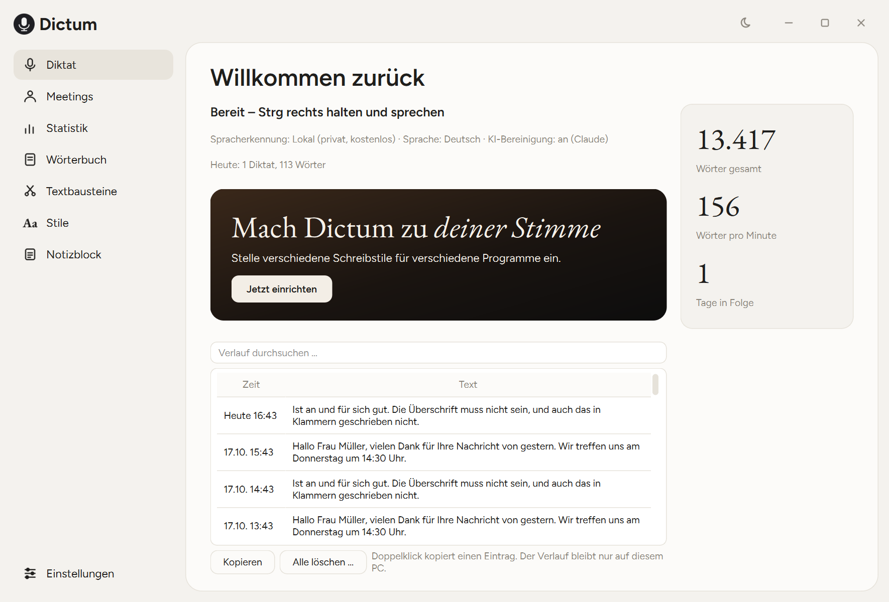
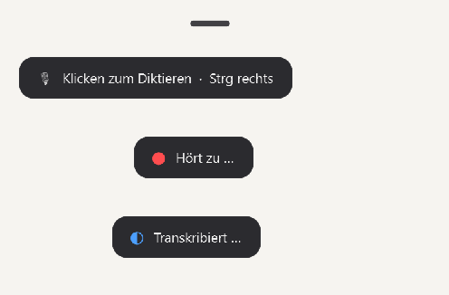
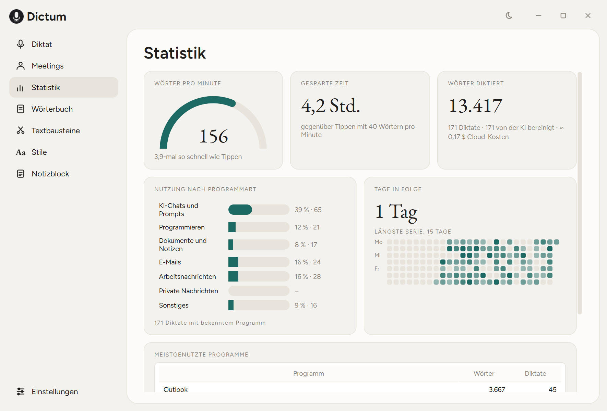

# Dictum 🎙️

Ein selbst gebautes **Sprach-Werkzeug für Windows**: Taste drücken, sprechen, und der Text steht sauber formatiert genau dort, wo der Cursor ist – in jedem Programm. Dazu ein Fenster mit Verlauf, Statistik, eigenem Wörterbuch und Stilen pro Programm, Meeting-Aufnahmen mit KI-Zusammenfassung und eine Handy-Web-App. Das Vorbild beim Diktieren ist [Wispr Flow](https://wisprflow.ai), bei den Aufnahmen [Pocket](https://heypocket.com) und [Plaud](https://plaud.ai). Dictum ist ein eigenständiges Projekt und steht in keiner Verbindung zu diesen Anbietern.

**Handy-Web-App (PWA):** https://vincentkoenig.github.io/Dictum/ *(braucht ein Dictum-Konto im eigenen Supabase-Projekt, siehe [Erste Schritte](#erste-schritte))*



> Die Bilder zeigen Beispieldaten, keine echten Diktate.

## Warum dieses Projekt?

Tippen ist langsam, und fertige Diktier-Dienste schicken jedes Wort an einen fremden Anbieter, ohne dass man steuern kann, wie, wohin und zu welchem Preis. Dictum zeigt, wie sich ein solches Werkzeug selbst bauen lässt: lokal oder in der Cloud erkennen, mit einem Sprachmodell nur **bereinigen** (nicht umschreiben), alles Persönliche auf dem eigenen PC behalten und jeden Baustein austauschbar halten. Das Projekt ist außerdem dafür gedacht, dass man am Ende **erklären kann, wie jedes Teil funktioniert**: Zu jedem Baustein gibt es eine Erklärung in [`docs/`](docs/), und der Code ist ausführlich kommentiert.

## Features

### 🎙️ Diktieren in jede App
- **Taste halten, sprechen, loslassen** (Push-to-talk) oder **kurz antippen** und später nochmal antippen: Die Aufnahme läuft dann freihändig weiter
- **Jede Taste frei wählbar**: einzelne Sondertasten (Strg rechts, F8 …), Kombinationen und sogar Maustasten (Mausrad-Klick, Seitentasten). Im Fenster auf „Ändern …“ klicken und die Taste einfach drücken
- **Esc** bricht eine laufende Aufnahme ab, ein **Zeitlimit** (Standard 20 Minuten) beendet vergessene Aufnahmen
- **Letztes Diktat erneut einfügen oder kopieren** per Tastenkürzel, falls ein Feld den Text verschluckt hat
- **Flüstermodus**: leise Sprache wird automatisch verstärkt und vom Sprachfilter nicht mehr als Stille weggeworfen
- Text landet per Zwischenablage und simuliertem Strg+V im aktiven Feld. Die **vorherige Zwischenablage kommt komplett zurück** (Bilder, formatierter Text, kopierte Dateien), und das Diktat taucht nicht im Win+V-Verlauf auf

### ✨ Smarter Text
- **KI-Bereinigung**: Füllwörter raus, Selbstkorrekturen angewendet („um drei, nein, um vier“), Satzzeichen, Zahlen und Listen. Die KI ist ein *Werkzeug, kein Assistent*: Sie darf nichts hinzufügen oder beantworten, und eine Plausibilitätsprüfung verwirft verdächtige Antworten (dann gilt der Rohtext)
- **Stile pro Programm**: locker in WhatsApp, förmlich in Outlook, neutral im Editor. Erkannt über das Programm oder bei Browsern über den Fenstertitel. Ein Stil ändert nur Groß-/Kleinschreibung und Satzzeichen, nie die Wörter
- **Kontext für Namen**: Der Fenstertitel („Re: Angebot Müller GmbH“) und auf Wunsch der Text im Eingabefeld helfen der KI, Namen richtig zu schreiben
- **Command Mode**: Text markieren, eine Taste halten, eine Anweisung sprechen („mach das kürzer“, „übersetze ins Englische“). Das Ergebnis ersetzt die Markierung, Strg+Z macht es rückgängig. Ohne Markierung schreibt die KI einen neuen Text
- **Wörterbuch, Textbausteine und Lern-Wörterbuch**: Namen und Fachbegriffe verbessern Erkennung und Bereinigung, Textbausteine werden per Zuruf eingefügt, und auf Wunsch lernt Dictum aus deinen Korrekturen im Textfeld

### 🫧 Flow Bar
- Kleine Blase unten in der Bildschirmmitte, immer sichtbar: ein schmaler Strich, der beim Überfahren größer wird. Ein Klick startet und beendet das Diktat
- Zeigt während der Arbeit „Hört zu …“, „Transkribiert …“, „Formuliert …“
- Stiehlt nie den Fokus, damit der Text im richtigen Programm landet
- Töne bei Start und Ende sind standardmäßig aus, einschaltbar mit einstellbarer Lautstärke



### 🖥️ Das Fenster
- Seitenleiste mit **Diktat**, **Meetings**, **Statistik**, **Wörterbuch**, **Textbausteinen**, **Stilen** und einem **Notizblock** zum Ausprobieren
- **Verlauf** mit Suche, den man lokal speichern, begrenzen oder ausschalten kann
- **Statistik**: Tempo (Wörter pro Minute), gesparte Zeit gegenüber Tippen, Wörter, Nutzung nach Programmart, Kalender der Serie, geschätzte Cloud-Kosten
- Hell, Dunkel oder wie Windows. Fenster ohne Windows-Titelleiste, eigene Schriften (Figtree und EB Garamond, wie bei Wispr Flow)
- Einstellungen als Dialog, Tray-Symbol, Autostart, Desktop-Symbol und Startmenü-Eintrag



### 🗣️ Gespräche aufnehmen und zusammenfassen
- Meetings am PC aufnehmen: **Mikrofon und PC-Ton** (Teams, Zoom, Meet) per WASAPI-Loopback, in Stücken von wenigen Minuten, in Sprechpausen geschnitten
- Upload nach Supabase, Transkription und **strukturierte Zusammenfassung** (Kernpunkte, To-dos, Entscheidungen, offene Fragen) mit vier Vorlagen: Meeting, Interview, Vorlesung, Notiz
- **Nichts geht verloren**: Alles liegt erst als Datei in einer Warteschlange und wird bei fehlendem Netz später hochgeladen, auch nach einem Absturz

### 📱 Handy
- **Web-App (PWA)** auf GitHub Pages: Aufnehmen, auch offline (Warteschlange im Browser), Liste, Suche, Detailansicht, Markdown-Export, Wörterbuch und Textbausteine, die mit dem PC abgeglichen werden
- **Android-App (Prototyp, Flutter)**: Hülle um die Web-App mit nativem Mikrofon-Dienst für Aufnahmen bei gesperrtem Bildschirm. Gebaut und getestet, **auf dem Handy aber noch nicht überzeugend** (Transkriptqualität, fehlende Sperrbildschirm-Benachrichtigung), deshalb ist der Fokus aktuell der PC

## Tech Stack


-41CD52?style=flat&logo=qt&logoColor=white)


**PC-App**
- **PySide6 (Qt)** – Fenster, Flow Bar, Tray-Symbol, Dark Mode, eigenes Stylesheet
- **faster-whisper** – lokale Spracherkennung auf der CPU (Modell „small“, Sprachfilter, Wörterbuch als Hinweis)
- **OpenAI API** – optionale Cloud-Erkennung (`gpt-4o-mini-transcribe`) und alternative Bereinigung
- **Claude API** – Standard für die Bereinigung und den Command Mode (Haiku 5.5)
- **pynput** – globale Hotkeys inklusive Maustasten, Tastendruck simulieren
- **pywin32, psutil, uiautomation** – Zwischenablage mit allen Formaten, aktives Programm, Text im Feld lesen
- **sounddevice, soundcard, soundfile** – Mikrofon, PC-Ton (WASAPI-Loopback), Opus-Aufnahmen
- **Figtree, EB Garamond** – mitgelieferte freie Schriften (SIL Open Font License, Lizenztexte in `desktop/assets/fonts`)
- **tomlkit** – Einstellungen schreiben, ohne die Kommentare der Datei zu verlieren
- **SQLite** – lokaler Verlauf und Statistik
- **PyInstaller** – baut `Dictum.exe`

**Backend und Handy**
- **Supabase** – Login, PostgreSQL mit Row-Level-Security, Audio-Speicher, Edge Functions (Deno/TypeScript) für Erkennung und Zusammenfassung
- **Vite, React, TypeScript** – Handy-Web-App als PWA, Auslieferung per GitHub Pages
- **Flutter** – Android-Hülle mit Mikrofon-Dienst (Prototyp)

## Architektur

```
 PC-App (Python, Qt)                                   Handy-Web-App (PWA)
 Taste → Mikrofon → Erkennung ─┐                       Aufnehmen, Liste, Suche
   lokal (faster-whisper)      │                                   │
   oder OpenAI-Cloud           ▼                                   │
        Rohtext → Snippet? → KI-Bereinigung (Claude/OpenAI)        │
                    │            Stil + Kontext + Wörterbuch       │
                    ▼                                              │
        Zwischenablage + Strg+V → aktives Textfeld                 │
        Verlauf + Statistik (SQLite, nur lokal)                    │
                                                                   ▼
 Meetings: Mikrofon + PC-Ton → Warteschlange → ┌──────────── Supabase ────────────┐
                                               │ Login · Datenbank · Audio-Speicher │
                                               │ Edge Functions → Whisper + Claude  │
                                               └────────────────────────────────────┘
```

Ausführlich: [docs/ARCHITEKTUR.md](docs/ARCHITEKTUR.md) · Fachbegriffe: [docs/GLOSSAR.md](docs/GLOSSAR.md)

### Warum diese Entscheidungen?

- **Erkennung und Bereinigung getrennt**: Whisper erzeugt den Rohtext, ein Sprachmodell poliert ihn nur. Die Bereinigung ist als „Werkzeug, kein Assistent“ gebaut: Diktiert man „Schreib eine Mail an Tom“, landet genau dieser Satz im Feld. Eine Plausibilitätsprüfung (zu lang, zu kurz, leer) fällt bei Zweifeln auf den Rohtext zurück, und bei jedem Fehler (offline, kein Key) wird der Rohtext eingefügt. Diktieren funktioniert also **immer**
- **Austauschbare Anbieter**: Erkennung lokal oder bei OpenAI, Bereinigung bei Claude oder OpenAI, alles zur Laufzeit umschaltbar. Eine gemeinsame Schnittstelle (`llm/`) hält den Rest des Codes unabhängig vom Anbieter
- **Hotkey-Logik ohne Tastatur**: Eine Zustandsmaschine (Halten, Antippen, Abbrechen, Zeitlimit) kennt die echte Tastatur nicht und ist deshalb mit Tests prüfbar. Der Command Mode benutzt dieselbe Maschine mit eigener Taste
- **Ein Stil ändert nur die Schreibweise**: So bleibt die Regel „nichts hinzufügen, nichts weglassen“ der Bereinigung bestehen
- **Datenschutz zuerst**: Kontext und Lern-Wörterbuch lesen Textfelder nur auf Wunsch, Passwortfelder nie, und Audio wird nicht gespeichert. Der Verlauf liegt in einer lokalen SQLite-Datei
- **Erst speichern, dann hochladen**: Meetings und Handy-Aufnahmen liegen zuerst als Datei in einer Warteschlange. Netzausfall, App-Absturz oder Neustart verlieren nichts
- **Eine Oberfläche für Handy und Browser**: Neue Funktionen der Web-App stehen sofort überall zur Verfügung, die Android-Hülle liefert nur, was ein Browser nicht kann (Aufnahme bei gesperrtem Bildschirm)
- **Persönliche Dateien getrennt vom Programm**: Als `.exe` liegen Einstellungen, Wörterbuch, Verlauf und Schlüssel in `%APPDATA%\Dictum`, damit ein Update das Programm einfach ersetzen kann

## Projektstruktur

```
Dictum/
├── desktop/                       # PC-App (Python, Windows)
│   ├── dictum/
│   │   ├── app.py                   # verbindet alles: Threads, Signale, Ablauf eines Diktats
│   │   ├── hotkey.py, keys.py       # Zustandsmaschine, Tastennamen, Maustasten, Tasten-Aufnahme
│   │   ├── audio.py, levels.py      # Mikrofon, Flüstermodus
│   │   ├── transcriber.py           # lokale Erkennung (faster-whisper)
│   │   ├── cloud_transcriber.py     # Erkennung über OpenAI
│   │   ├── cleanup.py, styles.py    # KI-Bereinigung, Stile pro Programm
│   │   ├── commands.py              # Command Mode
│   │   ├── learn.py                 # Lern-Wörterbuch aus Korrekturen
│   │   ├── context.py               # aktives Programm, Fenstertitel, Text im Feld
│   │   ├── inserter.py, clipboard.py  # Einfügen, Zwischenablage mit allen Formaten
│   │   ├── vocabulary.py, sync.py   # Wörterbuch und Textbausteine, Abgleich mit der Cloud
│   │   ├── history.py, costs.py     # Verlauf (SQLite), Statistik, Kostenschätzung
│   │   ├── meeting.py, meeting_controller.py, upload_queue.py, cloud.py  # Meetings und Upload
│   │   ├── config.py, settings_io.py  # settings.toml lesen und mit Kommentaren schreiben
│   │   ├── autostart.py, shortcuts.py, single_instance.py, logsetup.py   # echtes Programm
│   │   ├── sounds.py                # sanfte Töne
│   │   ├── llm/                     # Claude und OpenAI hinter einer Schnittstelle
│   │   └── gui/                     # Fenster, Seiten, Flow Bar, Tray, Dark Mode, Schriften
│   ├── assets/                      # Symbol, Schriften samt Lizenzen
│   ├── tests/                       # 221 Tests
│   ├── scripts/                     # build_exe.ps1, install_exe.ps1, End-to-End-Skripte
│   ├── dictum.spec                  # PyInstaller-Bauplan
│   └── settings.toml                # alle Einstellungen, jede Option kommentiert
├── pwa/                           # Handy-Web-App (Vite + React + TypeScript)
├── mobile/                        # Android-Hülle (Flutter), Prototyp
├── supabase/                      # Datenbank-Schema, Edge Functions (transcribe, summarize, dictate)
├── docs/                          # Architektur, Plan, Funktionsvergleich, Glossar, Erklärung pro Baustein
│   └── images/                      # Bilder für dieses README
└── .github/workflows/pwa.yml      # baut und veröffentlicht die Web-App
```

## Tastenkürzel und Einstellungen

Alle Tasten sind frei wählbar. Das hier sind die Standardwerte (`desktop/settings.toml`):

| Aktion | Standard | Hinweis |
|---|---|---|
| Diktieren | **Strg rechts** | halten = Push-to-talk, antippen = freihändig |
| Aufnahme abbrechen | **Esc** | fest eingebaut |
| Command Mode | **F9** | Text markieren, Anweisung sprechen; `[]` = aus |
| Letztes Diktat einfügen | Umschalt+Alt+Z | |
| Letztes Diktat kopieren | Umschalt+Alt+X | |
| Flow Bar | Klick auf die Blase | startet und beendet ein Diktat |

Eine Taste darf nicht in einer anderen Kombination stecken (sonst würde „Strg rechts“ schon das Diktat starten, bevor „Strg rechts + F9“ fertig gedrückt ist). Das prüft Dictum beim Speichern.

## Erste Schritte

### Variante A: fertiges Programm (`Dictum.exe`)

```powershell
git clone https://github.com/vincentkoenig/Dictum.git
cd Dictum\desktop
python -m venv .venv
.venv\Scripts\python -m pip install -r requirements.txt
powershell -File scripts\build_exe.ps1                    # baut dist\Dictum\Dictum.exe (ca. 350 MB, einige Minuten)
powershell -File scripts\install_exe.ps1                  # installiert nach %LOCALAPPDATA%\Programs\Dictum
```

Das Installationsskript legt Desktop-Symbol und Startmenü-Eintrag an und schaltet Autostart ein. Mit `-MigrateData` übernimmt es Einstellungen, Wörterbuch und Verlauf der Entwicklerversion, mit `-MigrateKeys` auch die Schlüsseldatei. Windows Defender kann bei einer unsignierten `.exe` beim ersten Start warnen.

### Variante B: aus dem Quellcode

```powershell
cd desktop
python -m venv .venv
.venv\Scripts\python -m pip install -r requirements.txt
.venv\Scripts\python -X utf8 -m dictum                    # oder: Doppelklick auf start.bat
```

Beim allerersten Start wird das lokale Whisper-Modell heruntergeladen (ca. 460 MB).

### API-Keys eintragen

`.env.example` nach `.env` kopieren (im Projektordner, bei der `.exe` in `%APPDATA%\Dictum`) und eintragen:

```
ANTHROPIC_API_KEY=dein_anthropic_key     # KI-Bereinigung und Command Mode
OPENAI_API_KEY=dein_openai_key           # optional: Cloud-Erkennung
DICTUM_EMAIL=...                         # Dictum-Konto für Meetings und Abgleich
DICTUM_PASSWORD=...
```

> Keys gibt es unter [console.anthropic.com](https://console.anthropic.com) und [platform.openai.com/api-keys](https://platform.openai.com/api-keys). Im Fenster öffnet *Einstellungen → Schlüssel → Schlüsseldatei öffnen* die Datei, *Schlüssel neu laden* übernimmt Änderungen ohne Neustart. **Ohne Keys diktiert Dictum trotzdem**, mit lokaler Erkennung und ohne KI-Bereinigung.

### Backend einrichten (nur für Meetings und Handy)

Das Supabase-Projekt, die Edge Functions und das Dictum-Konto sind in [supabase/README.md](supabase/README.md) und [docs/backend.md](docs/backend.md) Schritt für Schritt beschrieben. Die Web-App wird per GitHub Actions auf GitHub Pages veröffentlicht ([docs/pwa.md](docs/pwa.md)).

### Tests

```powershell
cd desktop
.venv\Scripts\python -m pytest                            # 221 Tests ohne Bildschirm, Mikrofon und Netz
```

Die Oberflächen-Tests laufen mit dem Qt-Plattform-Plugin „offscreen“. Die Zwischenablage-Tests benutzen die echte Zwischenablage und legen den vorherigen Inhalt wieder zurück.

## Kosten

Lokale Erkennung kostet nichts. In der Cloud (Preise der Anbieter, Stand Oktober 2026, in US-Dollar):

| Schritt | Modell | Preis |
|---|---|---|
| Erkennung | `gpt-4o-mini-transcribe` | ca. 0,003 $ pro Minute |
| Erkennung | `gpt-4o-transcribe` | ca. 0,006 $ pro Minute |
| Bereinigung | Claude Haiku 5.5 | 0,10 $ / 0,50 $ je 1 Mio. Token (Ein-/Ausgabe) |
| Bereinigung | `gpt-5-nano` | 0,05 $ / 0,40 $ je 1 Mio. Token |

Ein Diktat von 40 Sekunden kostet mit OpenAI-Erkennung und Claude-Bereinigung etwa 0,2 Cent. Die Statistik schätzt die Kosten pro Diktat. Im Vergleichstest mit demselben Text war die OpenAI-Erkennung gut doppelt so schnell wie lokales Whisper „small“ (ca. 2,6 s statt 8 s bei 41 s Audio) und machte weniger Fehler bei Eigennamen und englischen Fachwörtern.

## Dokumentation

| Datei | Inhalt |
|---|---|
| [docs/desktop.md](docs/desktop.md) | Ausführliche Erklärung der PC-App: Ablauf, Hotkeys, Stile, Command Mode, Fenster, `.exe` |
| [docs/ARCHITEKTUR.md](docs/ARCHITEKTUR.md) | Gesamtbild aus PC, Backend und Handy |
| [docs/backend.md](docs/backend.md) | Supabase: Schema, Row-Level-Security, Edge Functions |
| [docs/pwa.md](docs/pwa.md) | Handy-Web-App |
| [docs/mobile.md](docs/mobile.md) | Android-Hülle |
| [docs/FEATURES.md](docs/FEATURES.md) | Funktionsvergleich mit Wispr Flow, Pocket und Plaud |
| [docs/PLAN.md](docs/PLAN.md) | Projektplan nach Phasen |
| [docs/GLOSSAR.md](docs/GLOSSAR.md) | Fachbegriffe einfach erklärt |
